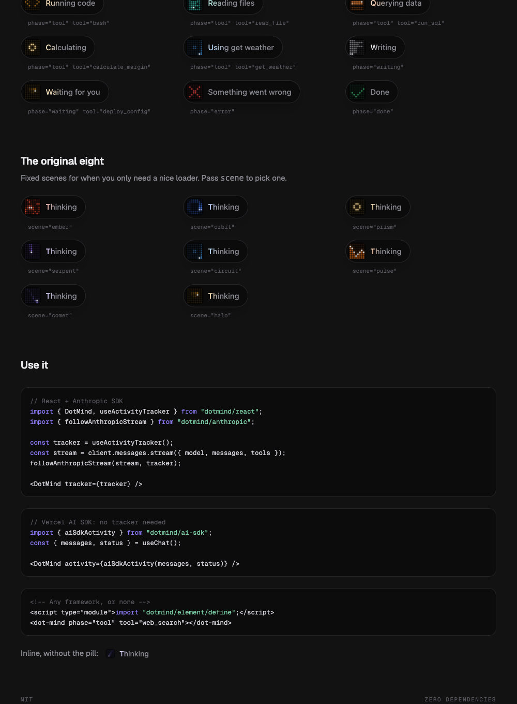

# dotmind

Dot-matrix status indicators for AI interfaces. Instead of a loader you switch on and off yourself, dotmind reads the model's stream and shows what the model is doing right now.



| The model is… | The dots show | The label says |
|---|---|---|
| reasoning | a comet tracing a figure-eight | Thinking |
| calling a search tool (`web_search`, `search_docs`, `grep`) | a radar sweep with blips | Searching |
| fetching or browsing (`web_fetch`, `navigate`) | a turning globe | Browsing |
| running code (`bash`, `code_interpreter`) | a cursor typing between `< >` | Running code |
| reading or editing files (`read_file`, `text_editor`) | a page being read line by line | Reading files |
| querying data (`run_sql`, `query_clickhouse`) | stacked disks lighting in turn | Querying data |
| calculating (`calculate_margin`, `plot`) | a breathing diamond | Calculating |
| any other tool (`get_weather`) | a trace around the edge | Using get weather |
| writing the answer | lines filling in as text arrives | Writing |
| waiting for approval | a slow spinner | Waiting for you |
| failed | a flashing cross | Something went wrong |
| finished | a check mark drawn in | Done |

The writing scene moves one dot for every four characters received, and the whole matrix speeds up and brightens with the token rate, then settles when the stream stalls. Scenes cross-fade into each other.

## Install

```bash
npm install dotmind
```

No runtime dependencies. React is an optional peer.

## React

```tsx
import { DotMind, useActivityTracker } from "dotmind/react";
import { followAnthropicStream } from "dotmind/anthropic";

function Reply() {
  const tracker = useActivityTracker();

  async function ask() {
    const stream = client.messages.stream({ model, max_tokens, messages, tools });
    followAnthropicStream(stream, tracker);
  }

  return <DotMind tracker={tracker} />;
}
```

With the Vercel AI SDK there is nothing to wire up; derive the activity from `useChat`:

```tsx
import { DotMind } from "dotmind/react";
import { aiSdkActivity } from "dotmind/ai-sdk";

const { messages, status } = useChat();
<DotMind activity={aiSdkActivity(messages, status)} />;
```

Or drive it yourself:

```tsx
<DotMind activity="thinking" />
<DotMind activity={{ phase: "tool", tool: "web_search" }} />
<DotMind scene="ember" label="Thinking" />
```

## Web component (Vue, Svelte, Angular, plain HTML)

```html
<script type="module">import "dotmind/element/define";</script>

<dot-mind phase="tool" tool="web_search"></dot-mind>
<dot-mind phase="writing" variant="bare" size="18"></dot-mind>
```

```js
const el = document.querySelector("dot-mind");
el.connect(tracker);
el.activity = { phase: "tool", tool: "run_sql" };
```

## Adapters

| Import | Source | Entry points |
|---|---|---|
| `dotmind/anthropic` | Anthropic Messages streaming events, including server tools (`web_search`, `web_fetch`, code execution) and MCP tool blocks | `followAnthropicStream(stream, tracker)`, `createAnthropicTranslator()` |
| `dotmind/openai` | OpenAI Responses API events, and Chat Completions chunks (also works for OpenRouter, Ollama, vLLM, DeepSeek `reasoning_content`) | `followOpenAIResponses`, `followChatCompletions`, `create…Translator()` |
| `dotmind/ai-sdk` | Vercel AI SDK 5 `UIMessage` parts plus `useChat` status | `aiSdkActivity(messages, status)` |

Anything else: push events into a tracker yourself.

```ts
import { ActivityTracker } from "dotmind";

const tracker = new ActivityTracker({ tools: { lookup_customer: "database" } });
tracker.push({ type: "start" });
tracker.push({ type: "tool", name: "lookup_customer", id: "1" });
tracker.push({ type: "tool-result", id: "1" });
tracker.push({ type: "text", chars: 42 });
tracker.push({ type: "finish" });
```

When a turn ends because the model asked your code to run a tool (`stop_reason: "tool_use"`, `finish_reason: "tool_calls"`), the indicator stays on that tool until the next turn starts.

## Options

| Prop / attribute | Default | |
|---|---|---|
| `activity` / `phase`, `tool`, `kind` | `idle` | What to show. A string is shorthand for `{ phase }`. |
| `tracker` / `.connect(tracker)` | | Follow a tracker; updates skip React renders. |
| `variant` | `pill` | `pill` or `bare` (no background, for inline use). |
| `size` | `28` | Matrix size in CSS pixels. |
| `label` | from state | Fixed text, or `false` to hide it. |
| `labels` | English | Override any label, e.g. `{ "tool:search": "Buscando" }`. |
| `palette` | | Recolour any scene: `{ radar: [0, 200, 120] }`. |
| `scene` | from state | Force one scene, ignoring the state. |
| `reducedMotion` | system setting | Show a still frame per state. |

CSS custom properties: `--dm-bg`, `--dm-edge`, `--dm-well`, `--dm-ink`, `--dm-peak`, `--dm-font`, `--dm-font-size`, `--dm-shimmer`.

Hidden indicators stop drawing, every indicator on a page shares one animation frame, and the label sits in a polite live region so screen readers hear "Searching", not every frame.

## Repo layout

```
packages/dotmind   the npm package (core, React, web component, adapters)
demo               live demo replaying recorded Claude and OpenAI turns
spec               the pattern contract other platforms port from
```

```bash
npm install --prefix packages/dotmind
npm test
npm run demo        # http://127.0.0.1:4317/
```

## Other platforms

The core is plain math: each scene is a function from time and progress to 64 brightness values. `spec/SPEC.md` pins that contract so SwiftUI and Jetpack Compose packages can live in this repo beside the web package and match it frame for frame.

## Credits

The pill-and-matrix look and the eight fixed scenes (`ember`, `orbit`, `prism`, `serpent`, `circuit`, `pulse`, `comet`, `halo`) are recreated from a design by [@guanmo_ai](https://x.com/guanmo_ai/status/2125789137353478251).

## License

MIT
